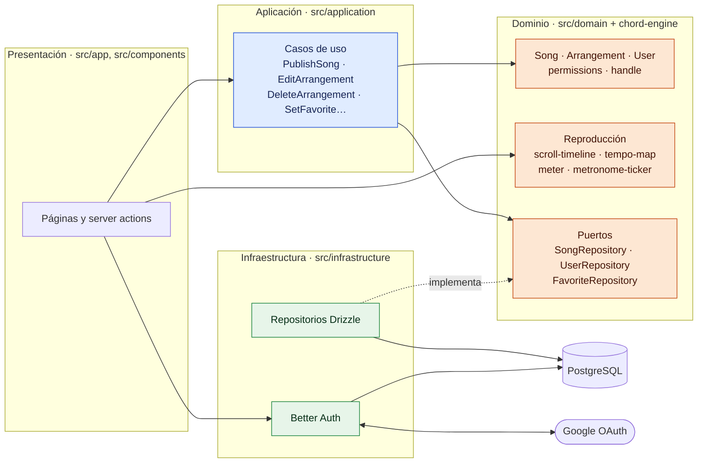
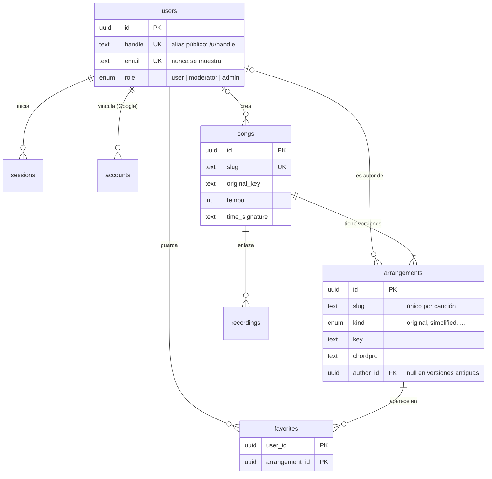
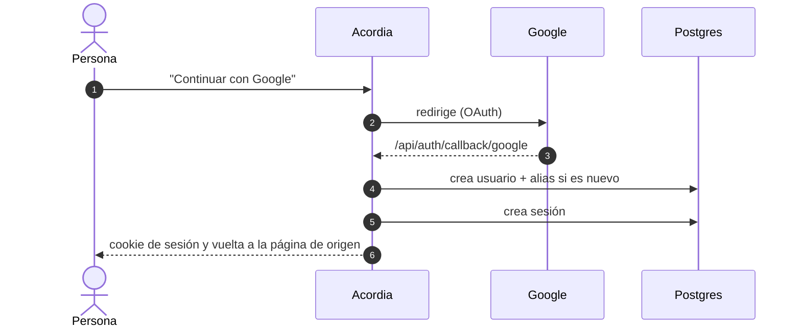
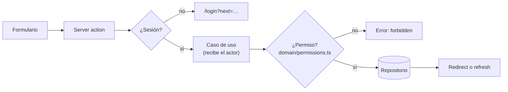

# Arquitectura de Acordia

Guía rápida de cómo está construida la web. Para levantarla en local, ver el [README](../README.md); para lo que se puede escribir en una canción, [song-format.md](song-format.md).

## Capas

Las flechas apuntan hacia dentro: el dominio no conoce Next.js, Postgres ni Google. `src/infrastructure/container.ts` es el único sitio que decide qué repositorio implementa cada puerto.

El motor de acordes (`packages/chord-engine`) es TypeScript puro y se usa igual en el navegador y en el servidor: parseo, transposición, importador, grados, digitaciones, directivas de tempo y orden de ejecución.

## Tocar una canción

El metrónomo es el reloj: todo lo demás sigue los compases que él cuenta.

```mermaid
flowchart LR
  cp["ChordPro<br/>de la versión"] --> tr["transposeChordPro<br/>(tono y cejilla)"]
  tr --> parse["parseChordProSong"]
  parse --> order["performanceOrder<br/>repeticiones, casillas, D.S."]
  order --> tl["buildScrollTimeline<br/>pasos y compases"]
  tl --> map["buildTempoMap<br/>tempo, compás y tono<br/>por compás"]
  map --> metro["Metrónomo<br/>MetronomeTicker"]
  tl --> scroll["Auto-scroll"]
  metro -- "start · beat(compás, tiempo) · stop" --> clock(("PracticeClock"))
  clock --> scroll
  scroll -- "dónde empezar · saltar a" --> clock
  clock --> metro
  scroll --> sheet["ChordSheet<br/>resalta y desplaza"]

  classDef engine fill:#fde7d3,stroke:#c2410c,color:#431407
  classDef ui fill:#e0ecff,stroke:#1d4ed8,color:#172554
  class tr,parse,order engine
  class metro,scroll,sheet ui
```

- **Línea de tiempo** (`domain/scroll-timeline.ts`): recorre las líneas en el orden en que se tocan y da a cada acorde su duración en compases. `lineBars` aplica las reglas de las barras `|`, y la vista de cuadrícula usa la misma función.
- **Mapa de tempo** (`domain/tempo-map.ts`): parte del tempo, compás y tono de la canción y añade una sección en el compás donde se alcanza cada directiva, incluida cada pasada de una repetición.
- **Metrónomo** (`components/metronome.tsx`):
  - programa los clics en el reloj de Web Audio con un poco de antelación;
  - en cada clic pide al mapa el tempo y el compás de su posición, así que las rampas y los cambios salen solos;
  - el BPM que pone la persona escala todo el mapa.
- **PracticeClock** (`components/practice-clock.tsx`): un bus de eventos, no estado de React, para que un tiempo no vuelva a dibujar la página.
  - El metrónomo emite `beat` con el compás y el tiempo que suenan.
  - El auto-scroll indica dónde empezar y puede pedir un salto, que se aplica en el siguiente "1".
- **Vistas** (`components/use-sheet-view.ts`): acordes, grados (`chordDegree`, con el tono de cada línea según `keysByLine`), solo letra y cuadrícula. Se recuerda en `localStorage`.

### Feature flags

`src/config/features.ts` lee variables de entorno en el servidor en cada petición, así que basta con reiniciar el servidor (no hay que recompilar). Ahora solo hay una: `FEATURE_AUTO_SCROLL`, que muestra la tarjeta de auto-scroll y hace que la hoja siga al metrónomo.

## Datos

- La **primera versión** de una canción (la original) lleva el tono, tempo y compás de la canción; las demás solo guardan tempo o compás si cambian.
- Borrar una cuenta **no** borra lo que publicó (`author_id` pasa a null); sí borra sus sesiones y favoritos.

## Entrar con Google

Better Auth hace todo el flujo. La única lógica propia es asignar el alias (`jonathan-guaynora`, `-2` si se repite) en `infrastructure/auth/auth.ts`.

## Una acción protegida

Publicar, editar, borrar y guardar en favoritos siguen el mismo camino:

La página también oculta los botones a quien no tiene permiso, pero eso es solo comodidad: **la comprobación que cuenta es la del caso de uso**.

## Quién puede editar o borrar una versión

Editar sigue la misma regla de permiso. Editar la original cambia también el tono, tempo y compás de la canción; la URL de una versión nunca cambia.

## Rutas

| Ruta | Qué es | Cuenta |
| --- | --- | --- |
| `/[lang]` | Buscar canciones | — |
| `/[lang]/songs/[slug]` | Canción (su versión original) | — |
| `/[lang]/songs/[slug]/[version]` | Otra versión | — |
| `/[lang]/songs/new` · `/[lang]/songs/[slug]/new` | Subir canción o versión | sí |
| `/[lang]/songs/[slug]/[version]/edit` | Editar versión | autor o moderador |
| `/[lang]/u/[handle]` | Perfil público | — |
| `/[lang]/favorites` | Tus favoritos (privados) | sí |
| `/[lang]/login` | Entrar | — |
| `/api/auth/*` | Better Auth (OAuth, sesión) | — |

`[lang]` es `es` o `en`; sin prefijo, `proxy.ts` elige el idioma del navegador.
