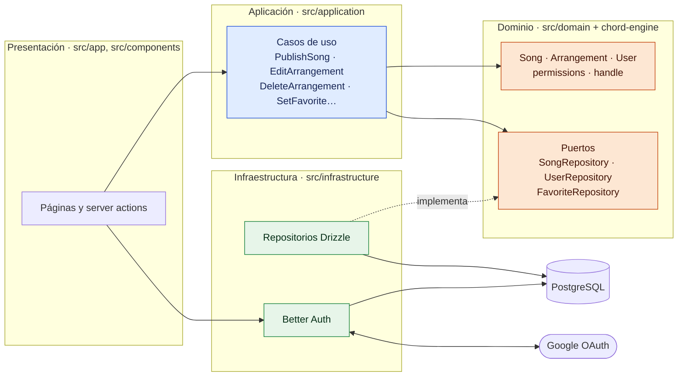
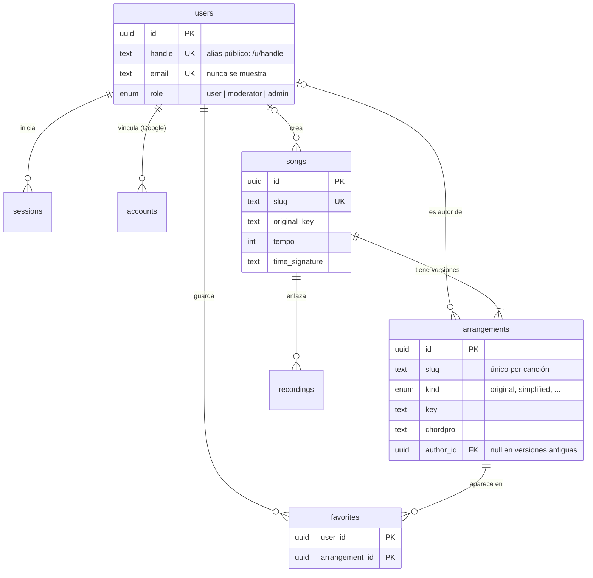
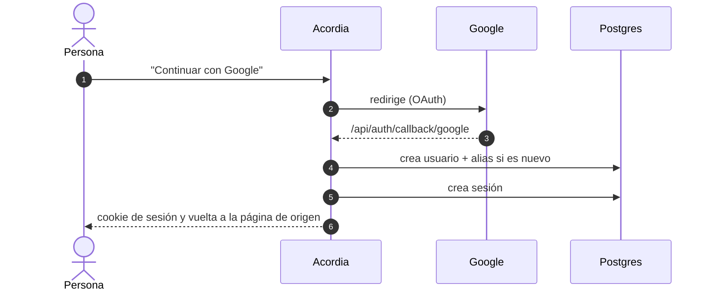
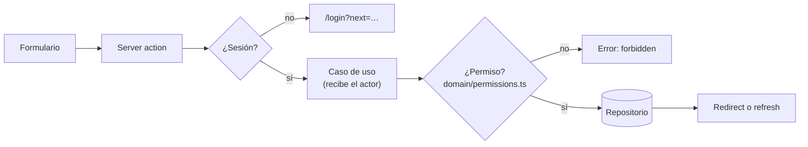
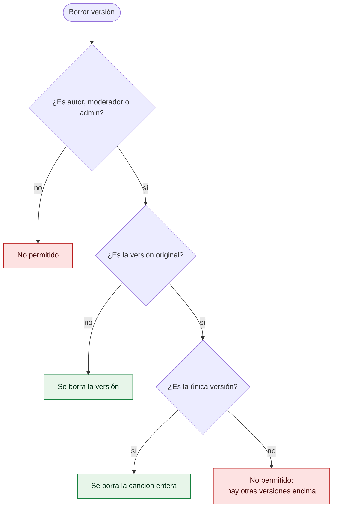

# Arquitectura de Acordia

Guía rápida de cómo está construida la web. Para levantarla en local, ver el [README](../README.md).

## Capas

Las flechas apuntan hacia dentro: el dominio no conoce Next.js, Postgres ni Google. `src/infrastructure/container.ts` es el único sitio que decide qué repositorio implementa cada puerto.

## Datos

- La **primera versión** de una canción (la original) lleva el tono, tempo y compás de la canción; las demás solo guardan tempo o compás si cambian.
- Borrar una cuenta **no** borra lo que publicó (`author_id` pasa a null); sí borra sus sesiones y favoritos.

## Entrar con Google

Better Auth hace todo el flujo. La única lógica propia es asignar el alias (`jonathan-guaynora`, `-2` si se repite) en `infrastructure/auth/auth.ts`.

## Una acción protegida

Publicar, editar, borrar y guardar en favoritos siguen el mismo camino:

La página también oculta los botones a quien no tiene permiso, pero eso es solo comodidad: **la comprobación que cuenta es la del caso de uso**.

## Quién puede editar o borrar una versión

Editar sigue la misma regla de permiso. Editar la original cambia también el tono, tempo y compás de la canción; la URL de una versión nunca cambia.

## Rutas

| Ruta | Qué es | Cuenta |
| --- | --- | --- |
| `/[lang]` | Buscar canciones | — |
| `/[lang]/songs/[slug]` | Canción (su versión original) | — |
| `/[lang]/songs/[slug]/[version]` | Otra versión | — |
| `/[lang]/songs/new` · `/[lang]/songs/[slug]/new` | Subir canción o versión | sí |
| `/[lang]/songs/[slug]/[version]/edit` | Editar versión | autor o moderador |
| `/[lang]/u/[handle]` | Perfil público | — |
| `/[lang]/favorites` | Tus favoritos (privados) | sí |
| `/[lang]/login` | Entrar | — |
| `/api/auth/*` | Better Auth (OAuth, sesión) | — |

`[lang]` es `es` o `en`; sin prefijo, `proxy.ts` elige el idioma del navegador.
